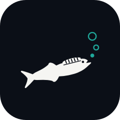

<p align="center"></p>

# Remora

**Self-hosted remote control for DSH (DeepSeek Harness).** View and drive your DSH sessions from ChatGPT, Claude, a CLI or an HTTP API through your own Cloudflare hub. Unofficial.

自分の Cloudflare ハブ経由で、ChatGPT・Claude・CLI・HTTP API から、すでに動いている DSH のセッションを見て、依頼して、終わったかどうかを知るためのプラグインです。DeepSeek とは関係のない非公式のプロジェクトです。

## しくみ

```text
ChatGPT / Claude / Claude Code / remora CLI / HTTP API / ハブの画面
        │  HTTPS（OAuth・パスキー）
        ▼
Cloudflare ハブ（Worker + Durable Objects、無料枠）
        ▲  WSS（DSH から外向き）
        │
DSH ホスト A, B, …（dsh-remora プラグイン）
```

- **ハブ**は自分の Cloudflare アカウントの無料枠を使って動かせます。追加課金を避ける場合は Workers Free を維持してください（上限超過時は操作が失敗することがあります）。ログインはパスキーだけ、外部クライアントは OAuth です。会話の本文は保存せず中継するだけです。
- **DSH 側**はプラグインを入れて、設定画面の「Remora」タブで接続・権限・範囲を決めます。DSH からハブへ外向きにつなぐので、DSH にポートを開ける必要はありません。
- **権限**は「見るだけ／依頼できる／リモート全権」と操作ごとのスイッチで決めます。上限は DSH の画面（この PC で開いた DSH Web）でしか上げられず、最終判定は毎回 DSH 側のプラグインが行います。

## 始め方

1. **ハブを立てる**: [hub/README.md](hub/README.md) の Deploy to Cloudflare ボタンを押し、`SETUP_TOKEN` に長いランダムな文字列を入れます。デプロイされた URL を開き、`SETUP_TOKEN` と一緒に最初のパスキーを登録します（2 本目の登録とリカバリーコードの保管もおすすめします）。
2. **プラグインを入れる**: [Releases](https://github.com/Aero123421/dsh-remora/releases) の `dsh-remora-<版>.tgz` の URL を、DSH Web の「Plugins → Add plugin」に貼ってインストールし、DSH を再起動します。
3. **ペアリング**: DSH の「設定 → Remora → 接続」にハブの URL を入れて「ペアリングを始める」を押します。表示された確認コードをハブの画面で確かめ、パスキーで承認します。
4. **権限と範囲**: 既定は「見るだけ」で、どのワークスペースも外から触れません。同じタブで、外から触ってよいワークスペースと、上限（たとえば「依頼できる」）を決めます。
5. **クライアントをつなぐ**: ハブの「接続」画面に手順があります。
   - ChatGPT: `chatgpt.com/plugins` の ＋ →「カスタム MCP サーバーを追加」に `https://<ハブ>/mcp`
   - Claude: カスタムコネクターに `https://<ハブ>/mcp`
   - CLI: `curl -fsSL https://github.com/Aero123421/dsh-remora/releases/latest/download/install.sh | sh` → `remora login https://<ハブ>`（Windows は `install.ps1`）

新しいクライアントは、どのホストでも「見るだけ」から始まります。ハブの「接続」画面で、クライアントごとに上限の範囲内で狭めたり取り消したりできます。

## できること

| 分類 | 操作 |
| --- | --- |
| 見る | ホスト・ワークスペース・セッションの一覧、セッションの概要と本文、会話の検索、コンテキストとトークン使用量、変更ファイルと差分、成果物、バックグラウンドジョブとその出力、スケジュールの一覧 |
| 依頼する | スキル付きのタスク投入（冪等キーつき、オフライン中は保留）、完了待ち（最長 25 秒ずつ）、追加指示、取り消し、再投入、新しいセッション（エージェントプリセットを選ぶ）、セッションのフォーク、ジョブの停止、決まった時間に依頼を送るスケジュールの追加・削除 |
| 応答する | AI からの質問とプランの確認への回答、承認・拒否（既定はハブでパスキー確認、DSH 側で許可すると MCP・CLI からも）、止まったゴールの再開。DSH Web を開いていなくても答えられます |
| 管理する | ワークスペースの作成（許可した置き場所の下だけ、Git クローンも可）、モデル・Effort の変更、許可したスラッシュコマンドの実行、ゴールの操作 |
| ハブの保守 | 監査ログの書き出しとハブの外での改ざん検査（`remora audit verify`）、ハブ設定の書き出し（秘密は含まない）、ホスト鍵の更新。CLI や API からの依頼は毎回ハブでオーナーがパスキーで承認します |
| リモート全権 | ワークスペースのフォルダでのコマンド実行（ターミナル）。毎回ハブでオーナーがパスキーで確認してから 1 回だけ動きます |

MCP のツール名と説明は `packages/protocol/src/operations.ts` で固定しています。

## できないこと・注意

- 質問・プランの確認・承認に外から答えられるのは、Remora がその依頼を受け付けている間だけです。DSH Web が開いていないときは「外からの回答を待つ時間」（既定 10 分、Remora タブの「権限」で変更、0 でオフ）だけ待ち、誰も答えなければ DSH は回答なしで続けます（承認は拒否扱い）。DSH Web が開いている間は、これまでどおり DSH Web の画面も待ち、先に答えた方が採用されます。
- 承認は、既定ではハブの要対応ページでオーナーのパスキーを使って答えます。DSH の Remora タブで「承認を MCP・CLI からも許可する」をオンにすると（この PC からだけ）、「依頼できる」権限のクライアントがパスキーなしで承認・拒否できます。
- ターミナルは、DSH 側の上限とハブでの付与がどちらも「リモート全権」（24 時間で「依頼できる」に戻ります）で、クライアントが `dsh.admin` スコープを持つときだけ使えます。依頼されたコマンドはすぐには動かず、ハブがオーナーに確認用の URL を出し、オーナーが内容を見てパスキーで確認したときだけ実行されます（10 分で期限切れ）。コマンドは DSH のサンドボックスの外で、DSH と同じユーザーとして動きます。
- 会話の検索は、DSH Web 自身の全文検索がオフのため、許可したセッションのログを新しい順に読んで探します（1 回 300 セッション・8 秒まで。超えると途中までの結果を返します）。
- スケジュールは DSH の「自動タスク」です。届くのはその PC で DSH Web が動いているときだけで、作るにはタスク投入と同じ条件（範囲内で、信頼済みのワークスペース）が要ります。Remora 経由で作ったものは 1 ホスト 20 件までで、DSH 側で緊急停止を入れるかペアリングを解除すると削除されます。
- `/permission` など権限・設定・データの持ち出しに関わるスラッシュコマンドは、どの権限でも外から実行できません。スキル・プリセット・コマンドは DSH 側で明示的に許可したものだけ使えます。
- Git でクローンしたワークスペースは「信頼していない」扱いで、DSH 側で信頼するまで外からタスクを送れません。
- DSH のサンドボックスが制限するのは書き込みだけで、読み取りとネットワークは制限しません。タスクを投げられるクライアントは、その PC のファイルを読ませて外へ通信させられます。
- 対応する DSH: `>=0.2.1-alpha.2 <0.2.2-0`

## 構成

| 場所 | 中身 |
| --- | --- |
| `packages/protocol` | ハブ・プラグイン・CLI が共有する取り決め（操作カタログ、入出力の型と入力スキーマ、権限判定、WebSocket のフレーム、ペアリング、パスキー確認）。唯一の正本 |
| `packages/dsh-remora` | DSH プラグイン（ホスト側と DSH Web の設定タブ）。GitHub Releases に tarball で配布 |
| `packages/cli` | `remora` コマンド。Windows・macOS・Linux 向けの単体実行ファイルで配布 |
| `hub/` | Cloudflare Worker。Deploy to Cloudflare ボタンでこのフォルダだけを複製できるよう自己完結させている |
| `e2e/` | npm 版の DSH とローカルのハブを使った通しテスト |
| `assets/` | ロゴ（コバンザメと泡） |

設計は [docs/design.md](docs/design.md)（設計書）と [docs/architecture.md](docs/architecture.md)（要点）、開発は [docs/development.md](docs/development.md)、通しテストは [docs/e2e.md](docs/e2e.md) にあります。npm には公開しません。

## プラグインの更新

[v0.1.7 の変更と検証](docs/releases/v0.1.7.md)には、狭い設定欄での折り返しの修正をまとめています。日本語の表示には [dsh-japanese](https://github.com/Aero123421/dsh-japanese) が必要です。ハブの画面と保存データはこの版では変えていません。[v0.1.6 の変更と検証](docs/releases/v0.1.6.md)には、ハブの日本語・英語・簡体字中国語への対応、画面刷新、導入案内の改善をまとめています。ハブの改善を使うには、プラグインだけでなく自分のハブも更新してください。

設定の「互換性と更新」で確認してから更新します。導入中・再起動待ち・実行版確認済みを区別し、通信切断後は同じ操作 ID を照合します。結果不明の場合は再送せず、DSH のプラグイン管理と実行版を確認してください。新しい版を入れられずプラグインが消えたときは前の版を入れ直し、その導入 ID を保存して再起動後も結果を追います。manager がない構成・read-only・開発用ディレクトリ・独自名の配布物は手動更新です。更新対象はプラグインの tgz だけで、CLI 更新や hub のデプロイは行いません。[v0.1.4 の変更と検証](docs/releases/v0.1.4.md)を参照してください。

## リリースの確かめ方

各リリースには、すべての配布物の `SHA256SUMS` と、GitHub Actions でビルドしたことを示すビルド来歴（attestation）が付いています。

```sh
sha256sum -c SHA256SUMS --ignore-missing
gh attestation verify dsh-remora-<版>.tgz --repo Aero123421/dsh-remora
```

## ライセンス

[MIT](LICENSE)。ロゴは独自に作ったもので、DSH の公式ロゴやブランド素材は使っていません（[NOTICE.md](NOTICE.md)）。
